# Benchmarks

The JMH benchmarks along with steps to reproduce are available in
the [benchmarks repository](https://github.com/daniel-rusu/pods4k-benchmarks).

<details>
<summary>Benchmark Setup</summary>

### Environment

The relative performance is displayed so that results remain stable across machines, even if the absolute throughput
changes. See [Result Normalization](#result-normalization) for details.

- Instrumented with [JMH](https://github.com/openjdk/jmh) to avoid JVM benchmarking pitfalls and produce more realistic
  results.
- JDK 17
- AMD Ryzen 9 5900HS
- Windows 11

### Measurement Process

1,000 collections are randomly generated with sizes chosen from the following probability distribution in order to
resemble typical real-world use-cases:

- 35% between 0 and 10 elements
- 30% between 11 and 50 elements
- 20% between 51 and 200 elements
- 10% between 201 and 1,000 elements
- 5% between 1,001 and 10,000 elements

To measure the performance of an operation, we measure how many collections can be processed per second. This is
repeated across 27 configurations: 3 collection types (lists, arrays, & immutable arrays) and 9 data types (String,
Boolean, Byte, Char, Short, Int, Float, Long, & Double). Each collection type operates on randomly-generated data using
the same seed in order to operate on identical data across the 3 collection types.

### Result Normalization

The relative throughput is displayed so we can say that an operation is `X` times faster when switching from one data
structure to another without talking about the exact throughput since that's dependent on the machine. Each chart is
independently normalized relative to the median list performance. Normalization allows us to visually gauge the impact
of switching data structures, and also gauge the impact of different data types.

**Example calculation:**

| Operation Performed On | Operation Throughput | Relative Throughput |
|------------------------|----------------------|---------------------|
| `List<Boolean>`        | `1,200` ops/sec      | `1.2`               |
| `List<Int>`*           | `1,000` ops/sec      | `1.0`               |
| `List<Float>`          | `900` ops/sec        | `0.9`               |
| `BooleanArray`         | `2,400` ops/sec      | `2.4`               |
| `IntArray`             | `2,000` ops/sec      | `2.0`               |
| `FloatArray`           | `1,800` ops/sec      | `1.8`               |

* Everything is normalized relative to `List<Int>` in this example as that's the median list performance.

</details>

<details>
<summary>Data Types</summary>

There are 9 Immutable Array types in this library. A generic `ImmutableArray<T>` and a specialized variant for each of
the 8 base types. Since regular arrays also have primitive variants, like-for-like comparisons are made with regular
primitive arrays (eg.`ImmutableFloatArray` vs.`FloatArray`).

Immutable Arrays make every effort to minimize auto-boxing without sacrificing readability, so clean code is efficient
by default. Developers write natural-looking code without thinking about primitives or auto-boxing and the library
automatically binds to the most efficient specialization:

```kotlin
val names = immutableArrayOf("Dan", "Jill") // ImmutableArray<String>
val luckyNumbers = immutableArrayOf(1, 2, 3) // ImmutableIntArray
```

Unlike lists or regular arrays, working with Immutable Arrays makes it natural to end up operating on primitives even
when starting with generic types:

```kotlin
// people is an ImmutableArray<Person>
val weightsInKilograms = people.map { it.weightKg } // ImmutableFloatArray since weightKg is a Float

// Extra-fast without any extra developer effort!
val babyIsPresent = weightsInKilograms.any { it < 5.0f }
```

Benchmarking 9 data types (generic + 8 primitive types) aligns with the most natural usage of this library as Immutable
Arrays automatically use primitives behind the scenes.
</details>

<details>
<summary>Operation Comparisons</summary>

When benchmarking operations, the user-facing behavior of these operations remains the same but the representation is
usually more efficient with Immutable Arrays. The benchmarks measure idiomatic usage that reflects real migrations, so
they measure the performance impact of performing the same actions before and after migrating to Immutable Arrays. While
operations on lists (such as `elements.filter { condition }`) produce lists, Immutable Array operations produce
Immutable Arrays. This was a deliberate architectural decision in order to:

### 1. Preserve immutability guarantees

We often share operation results in multiple places, so all Immutable Array operations should produce immutable results
to prevent mutation-related defects. Returning read-only lists breaks immutability guarantees as those can be mutated by
casting. Returning immutable lists from some other library would be strange architecturally and introduce additional
mutability gotchas. That's because `List` types automatically bind to Kotlin standard library operations, and these
bindings are automatically imported with higher precedence over custom extensions. Immutable lists could have developers
accidentally crossover into read-only lists when performing follow-on Kotlin standard library operations.

### 2. Preserve performance and efficiency expectations

If operations produced lists, follow-on operations would have different memory and performance profiles versus the same
operations on equivalent Immutable Arrays. These surprises make it difficult to reason about the memory and performance
of code since we would need to consider whether an operation is performed on an Immutable Array or on some other
intermediary list.

### 3. Avoid surprise transformations

From a new-developer perspective, the most natural expectation would be that filtering an ImmutableFloatArray would
produce a smaller ImmutableFloatArray with just the elements that passed the predicate. A similar argument applies for
other operations, so Immutable Array operations are designed to produce the most natural result type.

</details>

## Types of operations

Each category includes charts comparing lists, arrays, and Immutable Arrays for those types of operations.

* [Copy Elements](#copy-elements)
* [Conditional Copy](#conditional-copy)
* [Transformation](#transformation)
* [Categorization](#categorization)
* [Conditions](#conditions)
* [Miscellaneous](#miscellaneous)

### Copy Elements

Operations that copy ranges of values have significantly higher performance than lists and even regular arrays. The
smaller data types are split into a separate chart to avoid skewing the axis since their performance is too high!

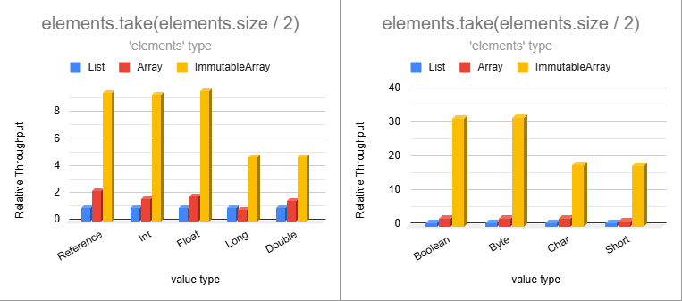

Operations on lists or regular arrays produce lists accumulating one element at a time. Immutable Array operations
generate immutable arrays in order to maintain immutability guarantees. This allows us to use bulk memory operations to
copy multiple elements at a time avoiding capacity & bound checks for each element.

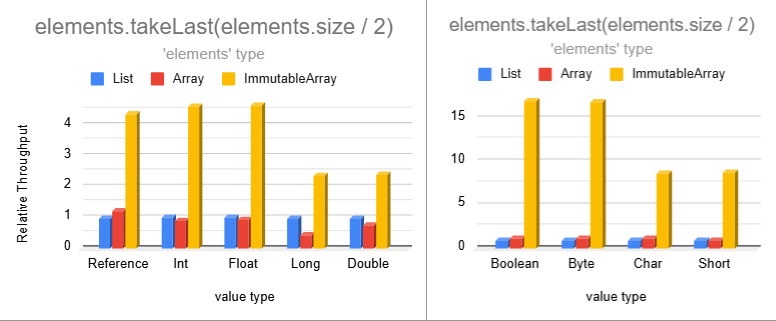

The `drop` and `dropLast` operations have similar relative performance as above.

### Conditional Copy

The `filter` operation uses a bitmap to keep track of the passing elements and determine the result size in advance.
This is much more efficient than dynamically growing a backing array, as it eliminates per-element capacity
checks and avoids repeatedly copying previous elements as it grows. This also reduces branching by using
bit-manipulation operations.

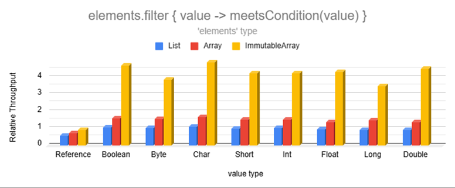

The `filterIndexed` and `filterNot` operations have similar relative performance as above.

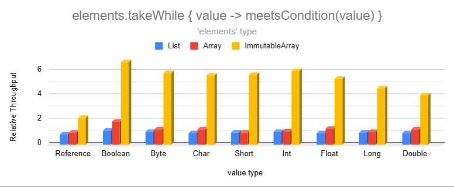

The `takeWhile` & `takeLastWhile` operations find the cutoff point and use bulk-memory operations to copy the
appropriate elements in bulk instead of copying elements one at a time.

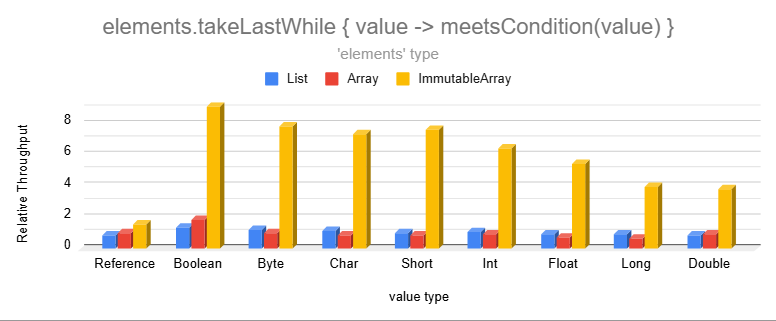

The `dropWhile` and `dropLastWhile` operations have even higher relative performance as above.

### Transformation

Transformations are faster than lists and even regular arrays because they avoid the per-element capacity checks.
Additionally, the lambda return type is used to bind to the most optimal Immutable Array type so that primitives are
stored efficiently without auto-boxing overhead.

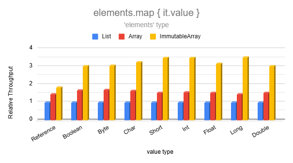

The `flatMap` operation also takes advantage of bulk memory operations to copy the nested elements in bulk.

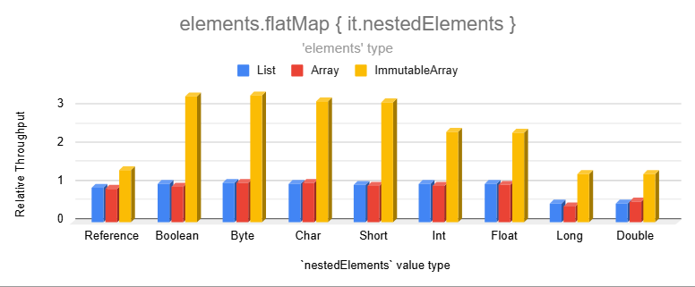

The Kotlin standard library doesn't have an overload for calling `flatMap` with nested arrays so we used
`elements.flatMap { it.nestedRegularArray.asList() }`. This is the most efficient possible baseline because `asList()`
returns a wrapper without copying the backing array.

### Categorization

Categorizing is much faster than lists and even regular arrays:

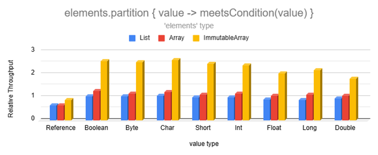

Partition is so fast because it uses a perfectly-sized double-ended buffer avoiding resizing as elements are added to
either side.

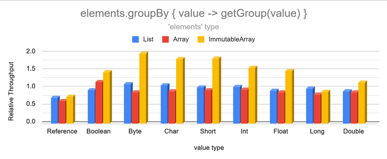

### Conditions

Immutable Arrays are much faster than lists when inspecting one of the 8 base data types:

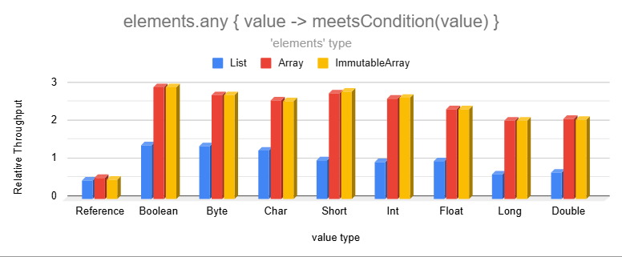

Lists store generic types forcing primitive values to be auto-boxed. This makes inspecting their values slower due to
reduced cache locality and extra indirection from the auto-boxed wrapper object.

### Miscellaneous

Sorting becomes extremely fast for smaller data types!

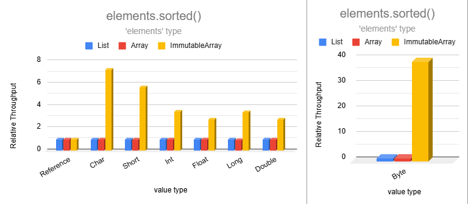

Combining two immutable arrays into a larger one is much faster than lists for most data types:

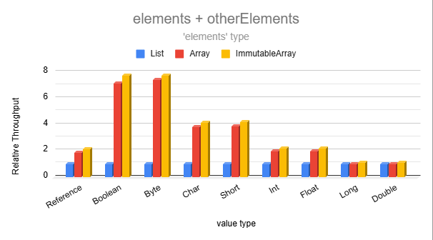

## Benchmark Summary

Immutable arrays are between 2 to 8 times faster than lists for many common operations with some scenarios over 30 times
faster!  Although there are many more operations, the above results should provide a pretty good representation of the
performance improvement of common non-trivial operations.

We don't usually think about primitives in Kotlin and the same is true with Immutable Arrays. Immutable Arrays allows us
to write clean list-like code, and the library automatically uses primitives when possible. This reduces memory
consumption and improves performance without having to think about primitives:

```kotlin
// primitive ImmutableFloatArray since weightKg is a Float
val weightsInKilograms = people.map { it.weightKg }

// Extra-fast while looking the same as regular list code
val babyIsPresent = weightsInKilograms.any { it < 5.0f }
```

These gains require no API changes or manual specialization from users.